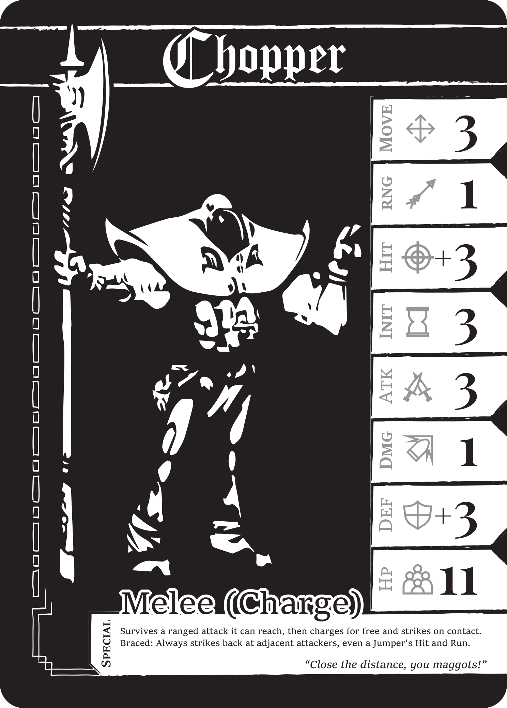

# Blackletter: Chronos

Oct 21, 2026 · @kr0 · revised from the code at tuning v2.14.6

**A tabletop general's war, on a real clock.** Command the Order of the Sun, a warband of armoured holy soldiers, across a hex battlefield where every unit acts the moment its gauge fills, and break the enemy by holding ground, not by clicking faster.

*The three unit cards, from the official Blackletter card art: [Chopper](../../../art/blackletter/cards/units/chopper.png), [Jumper](../../../art/blackletter/cards/units/jumper.png), [Shooter](../../../art/blackletter/cards/units/shooter.png).*

## The game in thirty seconds

1. **Place** three soldiers in secret: a Chopper, a Jumper and a Shooter.
2. **Wait for the bell.** Each unit's gauge fills in real time. A full gauge means it is ready, and it waits for your order as long as it takes.
3. **Take the ground.** Stand on the Reliquary and the Fortresses to earn Tithes and drain the enemy's Morale every second.
4. **Gamble your nerve.** Call a Secret Wager: the clock freezes, both commanders seal a Morale bid, both pay it, and the winner's army is blessed for 45 seconds (75 at the default pace).
5. **Break them.** At 0 Morale an army collapses. A battle takes about 14 minutes at the default pace, or 10 at the faster Snappy pace.

## Why it's different

| Pillar | What the player feels |
| --- | --- |
| **Grand tactics over reflexes** | At the default Grand Tactical pace a unit is ready every 25 to 50 seconds (16 to 31 at Snappy). A ready unit never loses its turn, so the game rewards reading the field. Pause any time against the AI and still give orders. |
| **Ground is the score** | No kill counter decides the battle. Holding more nodes bleeds the enemy's Morale continuously, so every march is a question of which ground to take, hold or give up. |
| **A wager of nerve** | The Secret Wager turns Morale, your life total, into a poker bid for a blessing. Bidding high can win the clash and lose the war. |
| **An illuminated manuscript at war** | Blackletter type, woodcut terrain and Roman Missal ornament, over a d6 rules core taken from a real tabletop game. |

*The muster: how a battle is won, pace, and Sebastion's skill.*

*The Secret Wager: one great seal in your colour, your bid, and the blessing it could buy.*

## Who it's for

- **Tabletop wargamers** who miss their weekly game and want rules they can read and trust.
- **Tactics-RPG players** raised on Final Fantasy's ATB who want to see who acts next.
- **Gothic-art devotees** of Blasphemous and Darkest Dungeon, who buy a game for its world.

It plays in the browser on desktop and phone, in English and Latin American Spanish.

## Who you fight

**Sebastion, Abbot of the Ashlands**, is the computer commander. He races you for the Reliquary, keeps his Choppers beside his Shooters and calls a Wager when a blessing is worth his Morale. He plays by the same rules as you: he never sees your sealed bid or your hidden starting positions. Easy, Normal and Hard change how closely he pays attention, never what he knows. You can also fight a friend on one screen or online by invite code.

## It's real and playable

|  |  |
| --- | --- |
| Play it | [blackletter-kr0nos-dev.web.app](https://blackletter-kr0nos-dev.web.app), behind Google sign-in |
| Modes | Practice against Sebastion with coaching, one-screen two-player, online by invite code |
| Tested by | 544 unit tests, a browser UI suite, and six rounds of play by seven AI player personas |
| What the personas said | Legibility rose from 2.7 to 4.0 out of 5 over six rounds, and Tone and craft held at 4.0 |
| In the lab | A 3D view on the same rules: an 81-hex battleground with walled Fortresses, rivers and roads, and a Wait mode that stops the clock for every order ([screenshot](screenshots/06-3d-view-battleground.png)) |
| Next | Playtest 3 with real players |
