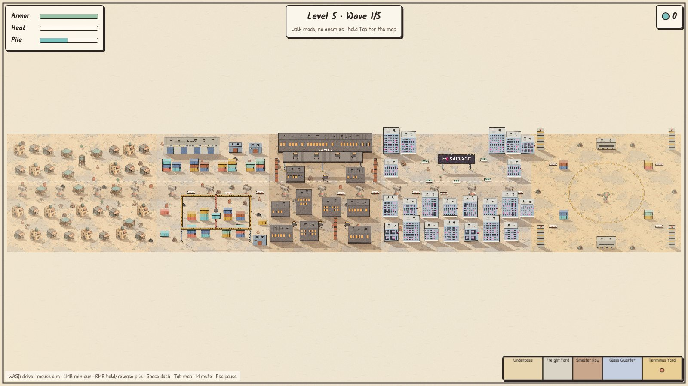

# Metr0niks level design: the ink prototype's five zones

Updated Oct 28, 2026 · @kr0 · Prototype: [`prototypes/prototype-ink.html`](prototypes/prototype-ink.html) · Layout: [`prototypes/ink-zones.js`](prototypes/ink-zones.js) · Voxel version: [level-design.md](level-design.md)

On Oct 28 kr0 asked for level design for the ink prototype (prototype 2): five different zones that end in a large boss area. Until now the ink prototype had a single small desert map. It now plays Overpass Sector 4 as five zones in a row, one opening per level, with the Terminus Yard arena at the end.

The two prototypes stay separate builds that follow the same rules (GDD-D32). So the ink map keeps what the GDD and `sim.js` set: the same five zones in the same order and proportions (read from `MetroSim.MAP.zones`), one zone opening per level (GDD-D47, in the GDD fun-pass PR), sealed zones drawn dark behind a blast shutter, the drop-in shot when a zone opens (`T.zone`: 5.5 s, shutter falls at 2.6 s), enemies only in open zones, level scaling (`T.level`), and collapse damage (`T.collapse`). What's different is how each zone looks and is laid out, drawn for the sun-bleached ink look in 2D. Where that needs a call from kr0, it's listed at the end.

## The sector at a glance

The map is 10,800 × 1,900 px: 50 px for each metre of the voxel map's length. North is up. Each zone has a north street (y 150 to 800), the old overpass band (y 830 to 1,080), where the broken pillars stand, and a south street (y 1,100 to 1,840). The deck itself fell long ago in the ink world, and its shadow band and lane paint end where the voxel deck ends, at the arena's entrance.

| | Underpass | Freight Yard | Smelter Row | Glass Quarter | Terminus Yard |
| --- | --- | --- | --- | --- | --- |
| x (px) | 0 to 2,400 | 2,400 to 4,200 | 4,200 to 6,000 | 6,000 to 8,400 | 8,400 to 10,800 |
| Opens at | Level 1 | Level 2 | Level 3 | Level 4 | Level 5 |
| District | Shanty market | Container yard | Furnace canyons | Financial district | The arena |
| Landmark | Water tower over the plaza | Gantry crane over the south yard | Slag gallery in front of the smelter | kr0 Salvage billboard over the plaza | Open sky and a painted ring of 600 px radius |
| Hazards | Water tower (falls on the plaza) | Container stacks (topple), crane | Slag vats, chimneys (fall over), gallery | Billboard | Short container stacks at the rim |
| Buildings | Adobe houses, tin shacks, market stalls | A warehouse and three tin sheds | Smelter hall, 9 iron halls, 3 chimneys | 22 glass towers in three heights | 4 pylons, 2 bunkers |
| Ground | Sand | Pale concrete wash | Scorched brown | Cool blue wash | Hazard ochre, painted ring |
| Plays like | Close range, corners every few steps | Long lanes between stacks, a set piece under the crane | Narrow canyons and things that fall on you | A grid of tall cover with a boulevard through it | An open finale: circle in the middle, cover at the edge |

Screenshots: [Underpass plaza](../../art/metr0niks/screenshots/ink-zone-01-underpass-plaza.jpg), [Freight Yard crane](../../art/metr0niks/screenshots/ink-zone-02-freight-yard-crane.jpg), [Smelter Row gallery](../../art/metr0niks/screenshots/ink-zone-03-smelter-row-gallery.jpg), [Glass Quarter billboard](../../art/metr0niks/screenshots/ink-zone-04-glass-quarter-billboard.jpg), [Terminus Yard arena](../../art/metr0niks/screenshots/ink-zone-05-terminus-yard-arena.jpg), [a shutter falling in the drop-in shot](../../art/metr0niks/screenshots/ink-zone-06-shutter-opens.jpg).

## Zones

### 1. Underpass (level 1): shanty market

- **North street.** Two blocks of adobe houses and tin shacks on alleys at both ends, and an open plaza in the middle with the water tower at its centre and three stalls around it. You drop in at the plaza's south edge, so the tower is the first thing you see.
- **Under the old deck.** Four broken pillars with market stalls between them, and open ground for bots to land on.
- **South street.** Two rows of tenements on alleys, with a small square in the middle and the tallest adobe at its north side.
- **Hazard.** Shoot out the water tower and its tank comes down on the plaza: collapse damage to everything within about 230 px. It teaches "the city is a weapon" in the first fight.

### 2. Freight Yard (level 2): container yard

- **North street.** A long warehouse ("FREIGHT 4") and two tin sheds line the wall. In front, a row of eight stacks, 2 or 3 containers high, leaves an apron in front of the warehouse and a lane behind the stacks.
- **Under the old deck.** Three pillars and three road barriers on open concrete: the breather between the two yards, and the longest run for a loader's charge.
- **South street.** The gantry crane covers the yard (1,140 × 530 px) on four steel legs, with a container hanging from the trolley over the central lane. Eight stacks stand in two rows under it, with single containers and a shed at the edges.
- **Hazards.** Destroy a stack and its upper containers topple off beside it, away from you: collapse damage where they land, and a fallen container stays there as new cover. Shoot out all four crane legs and the frame creaks for 0.9 s, then falls on the whole yard with its container.

### 3. Smelter Row (level 3): furnace canyons

- **North street.** The smelter hall fills the north wall. In front of it, the slag gallery (1,280 × 150 px, 150 px up) stands on three legs and carries four slag vats. A street vat stands at the junction in front of it, between two chimneys and two halls.
- **Under the old deck.** Three pillars and three barriers: the only open ground in the zone.
- **South street.** Seven iron halls of four sizes on narrow canyons, with a chimney and three vats where the canyons cross.
- **Hazards.** Shoot out the gallery's three legs and it falls with its vats, leaving four slag pools. A street vat dumps its slag where it stands. A chimney falls over away from you, in a line about 380 px long. The GDD's slag spill (a pool that burns for 8 s, GDD-D41) isn't in `sim.js` yet, so the pools are only decals for now.

### 4. Glass Quarter (level 4): financial district

- **North street.** Glass towers line the wall around a plaza. Over the plaza stands the billboard, a 600 px sign reading "kr0 SALVAGE" (the 0 in pink) on two legs, with planters for cover.
- **Under the old deck.** Four pillars and four barriers on the boulevard, the fastest way through the zone. The last pillar stands just before the arena.
- **South street.** Two rows of towers on a grid, eight in the first row and seven in the second, with cross streets between every pair.
- **Hazard.** Shoot out both legs and the billboard falls forward onto the plaza.

### 5. Terminus Yard (level 5): the arena

The old deck ends at the Glass Quarter's edge, so the last zone has open sky. It is the largest zone, 2,400 × 1,900 px, built for a big boss fight.

- **The floor.** A dashed ochre ring of 600 px radius (the voxel arena's 12 m) is painted in the middle. Nothing stands inside it.
- **The rim.** Four pylons in the corners, two bunkers mid-wall north and south, four short stacks with barriers on the diagonals just outside the ring, and scrap heaps at the edges. Cover is always at the edge, so the middle stays open.
- **Bosses.** A level's bosses drop into the zone that level opened, so all of level 5's bosses fight in the arena. Bots and loaders still drop near you wherever you are.

## How it plays by level

- **Level 1:** the Underpass only. You land at the plaza, and the water tower is the first collapse a new player sees.
- **Levels 2 to 5:** you land in front of the shutter the level opens. The camera leaves the mech, pans to the shutter, the shutter falls into debris at 2.6 s, the zone lights up and the camera returns before wave 1 (`T.zone`). Input is locked and the mech takes no damage during the shot.
- **Enemies** drop only into open zones (GDD Map, Zones). Bots and loaders come down 380 to 1,500 px from the mech, so a long sector doesn't leave the fight on its far side. Bosses drop into the newest zone.
- **Level scaling** follows `T.level`: at level 5, enemy counts are ×2, health and damage ×1.6, and scrap ×1.4.
- **Extract** climbs a level. Extracting level 5 clears the sector and starts the climb again at level 1. Getting wrecked restarts the climb at level 1, as in the GDD.

For review, the garage has a level picker that jumps to any level, and an "Enemies: off" switch to walk the map. Hold **Tab** for the whole sector. These are test controls, not game rules. The page also takes `?level=3&walk=1&auto=1` to drop straight in.

## How it is built

- `prototypes/ink-zones.js` holds the layout (every prop's position, zone by zone) and the code that draws the new buildings. `prototype-ink.html` loads it after `sim.js` and reads the zone list from `MetroSim.MAP`.
- **Art.** Houses, shacks, stalls, the water tower, pillars and small props are the Scenario atlas sprites. Everything new is drawn in code in the same palette and ink line: containers and stacks, the warehouse and sheds, iron halls, chimneys, vats, glass towers, planters, barriers, pylons, bunkers, steel legs, and the crane, gallery and billboard. They cast the same hatched shadows and take the same bites when damaged.
- **Landmarks** are an overhead layer held up by leg props (20 health each, like the voxel steel legs). When the last leg breaks, the landmark creaks for `T.collapse.warn` (0.9 s), then falls on its footprint: `T.collapse` damage to every mech under it, 150 damage to every prop under it, debris, rubble and scrap. Standing under one, it turns see-through so you can see your mech.
- **Performance.** The sector is about four times the size of the old map, so only the part that changed is re-baked when something breaks, and props off screen aren't drawn. In headless Chromium with software rendering, a level 4 fight runs at about 39 frames a second (the old single map ran at about 45 in the same test).

## What needs kr0

1. **Drop-in point.** The ink prototype lands you in front of the zone that is opening. The voxel map lands you at the Underpass plaza every level (`MAP.spawn`), which at level 5 means a 168 m walk to the arena. Pick one for both prototypes; I'd use the ink rule.
2. **The big boss.** The arena is sized for the GDD's Warden (GDD-D51), but the Warden isn't in `sim.js` yet, so for now level 5's bosses are the usual sniper, fighting from the arena.
3. **The overpass in ink.** The ink pillar art is a broken stub, so in this world the deck has already fallen and there are no span collapses. In the ink version, the Underpass's hazard is the water tower instead of the spans (GDD Zone identity says the Underpass is about dropping spans). If you want the deck back in ink, it needs a deck-span sprite and an overhead layer like the crane's.
4. **Zone enemies and the slag spill.** The Freight Yard Scuttlers, Smelter Row Bulwark, Glass Quarter Wrecker and Terminus Yard Elites (GDD-D40) and the slag spill (GDD-D41) go into `sim.js` first, then into both prototypes.
5. **Art for the new buildings.** The drawn-in-code buildings are stand-ins and look flatter than the Scenario sprites beside them. One Scenario parts sheet per zone (GPT Image 2.5 at about 4 credits each, using the existing ink prompts as the style reference) would bring them up to the atlas's level.
