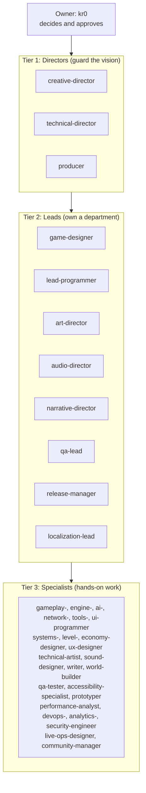
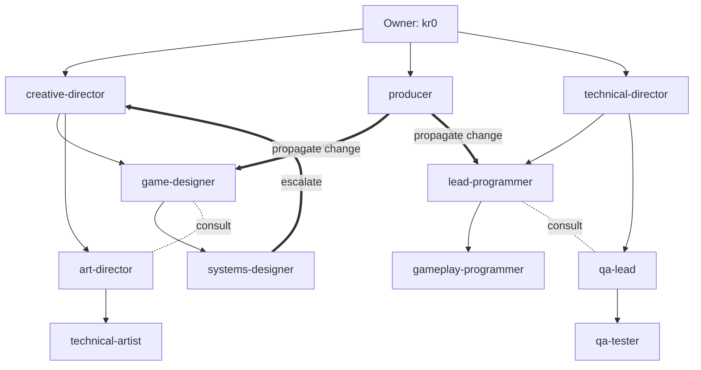
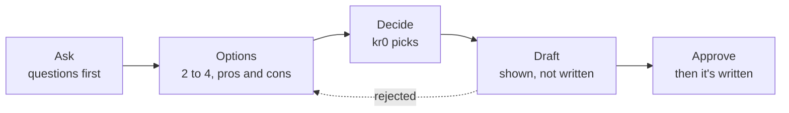
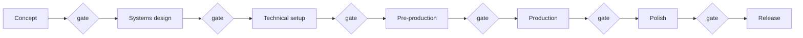
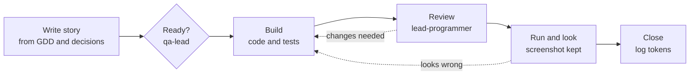
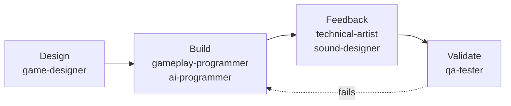
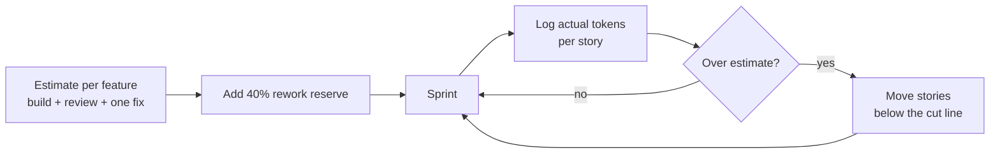

# kr0 Game Studio: Ways of Working

Last updated: 23 October 2026 · Owner: kr0

kr0 Game Studio makes small indie games with a crew of AI agents. It runs like a small studio. Directors guard the vision, department leads own their areas, and specialists do the hands-on work. One human, kr0, makes every decision. We plan work in **tokens**, not hours.

This document covers who does what, how work moves between agents, the checks that keep it honest, and how we budget.

---

## 1. Principles

1. **The owner decides.** Agents ask questions, offer options and show drafts. kr0 picks, and approves before anything is written.
2. **Budget in tokens.** Every feature carries a token estimate. Sprints close by comparing spend to estimate.
3. **Play it, then close it.** A change the player can see is done only after someone has run the game and kept a screenshot.
4. **Process to fit the game.** Use the lightest process that works. More documents don't make a better game.
5. **Every number is data.** Tunable values live in data files and one tuning table, never hard-coded. Each game has a headless deterministic simulation, and tuning changes are backed by its runs: see [simulation and tuning](simulation-and-tuning.md).
6. **Decisions are written down.** Settled debates go in the decision histories so they stay settled.

---

## 2. The crew

The studio has 49 agent roles in three tiers, plus engine specialists. A game only staffs the roles it needs. Metr0niks uses fourteen; Dropfront and Dual Tech use twelve each.

### Tier 1: Directors

| Role | Responsible for |
| --- | --- |
| creative-director | Vision, pillars and tone. Settles design disputes. |
| technical-director | Architecture, tech stack and performance strategy. Settles technical disputes. |
| producer | Sprints, milestones, risk, the token budget, and changes that cross departments. |

### Tier 2: Department leads

| Role | Responsible for |
| --- | --- |
| game-designer | Mechanics, systems, progression and balance. Owns the GDD. |
| lead-programmer | Code structure, code review and interfaces between systems. |
| art-director | Art bible, style guides and asset standards. |
| audio-director | Music direction, sound palette and audio approach. |
| narrative-director | Story, world and character direction. |
| qa-lead | Test strategy, bug triage and release readiness. |
| release-manager | Builds, versions, changelogs and deployment. |
| localization-lead | Text extraction, translation pipeline and locale testing. |

### Tier 3: Specialists

| Role | Responsible for |
| --- | --- |
| systems-designer | Formulas, loops and tunable values for a mechanic. |
| level-designer | Map layouts, pacing and encounters. |
| economy-designer | Currencies, prices, drops and progression curves. |
| gameplay-programmer | Feature and gameplay code. |
| engine-programmer | Core engine, rendering, physics and memory. |
| ai-programmer | In-game agents: behavior, pathfinding, state machines. |
| network-programmer | Netcode and online play. |
| tools-programmer | Editor tools and pipeline utilities. |
| ui-programmer | Screens, HUD and widgets. |
| ux-designer | User flows, wireframes and input handling. |
| technical-artist | Shaders, effects and the art pipeline. |
| sound-designer | Sound effects, event lists and mixing notes. |
| writer | Dialogue, lore and item text. |
| world-builder | World rules, factions and geography. |
| qa-tester | Test cases, playtests and bug reports. |
| accessibility-specialist | Colour-blind modes, remapping, text size and timing assists. |
| prototyper | Throwaway prototypes that test whether a mechanic is fun. |
| performance-analyst | Profiling and optimisation advice. |
| devops-engineer | Build scripts, CI and version control workflow. |
| analytics-engineer | Event tracking and dashboards. |
| security-engineer | Cheat prevention, save protection, network security. |
| live-ops-designer | Events, seasons and the live economy. |
| community-manager | Patch notes, player feedback and communication. |

**Engine specialists.** Each engine has a lead specialist and sub-specialists, used only for the engine a game picks: Godot (GDScript, C#, shaders, native extensions), Unity (DOTS, shaders, addressables, UI) and Unreal (ability system, Blueprints, replication, UMG).

### Crews per game

| Game | Agents staffed |
| --- | --- |
| Metr0niks | creative-director, technical-director, producer, game-designer, systems-designer, economy-designer, level-designer, gameplay-programmer, engine-programmer, ai-programmer, technical-artist, ux-designer, qa-tester, prototyper |
| Dropfront | creative-director, technical-director, producer, game-designer, systems-designer, economy-designer, gameplay-programmer, ai-programmer, ui-programmer, sound-designer, qa-tester, prototyper |
| Dual Tech | creative-director, technical-director, producer, game-designer, systems-designer, gameplay-programmer, ai-programmer, ui-programmer, sound-designer, art-director, accessibility-specialist, qa-tester |

---

## 3. Chain of command

1. **Delegate down.** Directors hand work to leads, leads to specialists. Complex decisions never skip a tier.
2. **Consult sideways.** Agents on the same tier can ask each other, but can't make binding decisions outside their area.
3. **Escalate up.** Disagreements go to the shared boss. With no shared boss, the creative-director settles design questions and the technical-director technical ones.
4. **The producer carries changes.** A design change that touches several departments is coordinated by the producer, so every affected doc and story is updated.
5. **Stay in your folders.** An agent never edits files outside its area unless asked to.
6. **Read documents by section.** A brief names the sections an agent needs. Big docs are read one section at a time.
7. **Never post upstream.** Agents never file issues or pull requests on engine, plugin or vendor projects. They draft; kr0 decides whether to send.

---

## 4. Asking before acting

Agents are collaborators, not an autopilot. Every task follows five steps.

- Before writing, an agent asks "May I write this to *file*?" and shows the draft or a summary.
- A change spanning several files is approved as one set.
- No commits unless kr0 asks for one.
- A skipped or dismissed question is not a yes. The agent acts on nothing and asks again.

**Automation level.** How often agents stop to ask is a setting:

| Setting | Behavior |
| --- | --- |
| Collaborative (default) | kr0 approves every step and every hand-off. |
| Guided | Work moves on automatically between steps unless something is blocked. |
| Autonomous | Runs end to end and logs every decision for kr0 to review. Some categories always ask regardless. |

---

## 5. Production phases

A game moves through seven phases. A gate check sits between each pair. Gates advise; kr0 decides whether to move on.

| Phase | What gets made |
| --- | --- |
| Concept | Pitch, pillars, game concept, art direction. |
| Systems design | A map of the game's systems, then a GDD section per system. |
| Technical setup | Engine choice, architecture decisions, visual identity, accessibility foundations. |
| Pre-production | UX and asset specs, a prototype of the core mechanic, stories, proof it's fun. |
| Production | Sprints: pick a story, build it, close it. |
| Polish | Performance, balance, playtests, bug fixing. |
| Release | Launch checklist, certification, shipping. |

**Minimal path.** For jams and prototypes: pick the engine, write a one-page brief (pitch, must-have features, build order), turn it into stories, and build. No GDD required.

### Review gates

Directors and leads review specific work along the way.

| Gate | Reviewer | Question |
| --- | --- | --- |
| Pillar stress test | creative-director | Are the pillars distinct enough to settle real arguments? |
| GDD pillar alignment | creative-director | Does each new system serve a pillar? |
| Systems check | creative-director | Does the systems map fit the vision? |
| Playtest review | creative-director | Does the playtest show the intended experience? |
| System boundaries | technical-director | Are system boundaries clean before the GDD is written? |
| Technical feasibility | technical-director | Can the risky parts be built? |
| Architecture sign-off | technical-director | Is the architecture and each decision record sound? |
| Scope check | producer | Does the plan fit the token budget? |
| Sprint and milestone review | producer | Is this sprint realistic? What are the milestone risks? |
| Art bible sign-off | art-director | Is the visual direction ready before assets are made? |
| Code review | lead-programmer | Is each finished story's code sound? |
| Story ready | qa-lead | Can the acceptance criteria be tested? |
| Test coverage | qa-lead | Were they tested before the story closes? |

---

## 6. The story loop

In production, all work is a **story**: one small, testable slice of a feature with acceptance criteria, grouped into epics.

- A passing test says nothing about a menu drawn off-screen. Any story that changes what the player sees closes only after the game has been launched, watched, and a screenshot filed as evidence. This holds at every process level.
- When the story closes, the producer logs the tokens it used in the game's tuning history.

### Sprints

The producer plans each sprint from the ready stories, sized by token estimate. At the sprint close the studio reviews spend against estimate, runs a short retrospective, and moves stories below the cut line if the budget is overrun.

---

## 7. Feature teams

Features that cross departments run as a small team with a fixed hand-off order.

| Team | Used for |
| --- | --- |
| Combat | Weapons, timing hits, enemies. Our most-used team (Metr0niks heavy hits, Dual Tech dual techs, Dropfront drop-ins). |
| UI | HUD, menus, garage and card hand. |
| Level | Maps and encounters. |
| Audio | Sound sets and music sync. |
| Narrative | Story and lore, with a consistency review every time. |
| QA | Test plans, regression and soak runs. |
| Polish | Performance, feel and bug fixing. |
| Release | Release checklist and patch notes. |
| Live ops | Events and seasons. |

**Team size.** At the smallest size, one specialist runs the whole pipeline and consults the others. At small size, every team member is spawned. At studio size, engine sub-specialists and an adversarial review pass are added. The active set is always announced before work starts.

**Parallel work.** Agents whose inputs are independent run at the same time. An agent that needs another's output waits for it. If one is blocked, it's reported at once and a partial report is still produced.

---

## 8. How much process

One setting, **rigor**, controls how much documentation and review a game gets.

| Rigor | Design docs | Director review | QA evidence | Best for |
| --- | --- | --- | --- | --- |
| Minimal (default) | One-page brief, then stories | None (solo) | Minimal; the run-and-look rule still applies | Jams, prototypes |
| Standard | 5 required GDD sections per system | Phase gates only (lean) | Standard | A semester build |
| Full | All 8 GDD sections, thorough | Every gate (full) | Full on every story | A commercial release |

We default light on purpose. When the same brief was built at two levels, the heavier one wrote 30 documents before its first line of code and was ranked last by blind reviewers and a playtest. The extra documents bought traceability, not a better game.

- **Raise one system.** A single system can get a higher standard than the rest, for example Dual Tech's timing engine or Metr0niks' destruction.
- **Per-run override.** Any review step can be run at full, lean or solo for one run.
- **Strict tests by type.** For each test type (logic, integration, visual, UI, config) we choose whether missing evidence blocks a story or only warns.

---

## 9. Guardrails

Automatic checks run while agents work.

| When | What it checks |
| --- | --- |
| Commit | Hard-coded values, to-do format, data file validity, required design-doc sections. |
| Push | Warns on protected branches, tags, merges and store uploads. |
| Reading a design doc | A doc over 40 KB can't be read whole; the agent gets the headings and reads one section. |
| Writing a file | Warns when a write would break a stated rule: a file never overwritten, the prototype boundary, a translation freeze. |
| Registry edits | Warns when an entry would be deleted or renumbered. |
| Asset changes | Data files must be valid; asset names must follow the convention. |
| Session start | Shows the branch and recent commits; spots missing design docs. |
| Agent start and stop | Audit trail; warns if an agent stops without writing the file it was asked for. |
| Always | Force pushes, recursive deletes and reading secret files are blocked. |

### Rules by folder

| Folder | Rule |
| --- | --- |
| gameplay | Values from data files; frame-time based movement; no UI references. |
| core | No allocations in hot paths; thread-safe; stable interfaces. |
| ai | Performance budgets; debuggable; parameters in data. |
| networking | Server decides; versioned messages; secure. |
| ui | Doesn't own game state; ready for translation; accessible. |
| design/gdd | Required sections; formulas in a set format; edge cases listed. |
| design/narrative | Lore consistency; character voice. |
| data files | Valid, named by convention, follow the schema. |
| tests | Naming, coverage and fixture rules. |
| prototypes | Relaxed standards, but a README and a stated hypothesis are required. |

### Memory between sessions

Each session keeps a checkpoint file. After a crash, a reset or a summarized conversation, the agent reads the checkpoint first: the file is the memory, not the chat. Helper scripts report observations and never verdicts, so a script can't overrule a setting it can't see.

---

## 10. Tokens, not time

Agents don't bill hours, so we plan in tokens: the unit of text an AI model reads and writes.

- **Estimate by feature.** A feature built by an agent, with review and one round of fixes, usually costs hundreds of thousands to a few million tokens.
- **Count input.** Every call re-reads the docs and code it touches, so input tokens are most of the bill (about 85% on our estimates). Reading docs by section is the biggest saving.
- **Hold a reserve.** Every budget adds 40% for rework.
- **Track and re-plan.** Actual tokens per story go into the game's tuning history. The producer compares spend to estimate at every sprint close, and overruns move stories below the cut line rather than stretching the budget.
- **Match the model to the job.** Directors run on the strongest model. Most specialists run on the session's model, which keeps most tokens on cheaper calls.
- **Runtime is separate.** In-game agents that call a model while someone plays need their own per-session budget. Our current games run in-game agents on fixed rules, so runtime cost is zero.

### API constraints we plan around

| Constraint | How we handle it |
| --- | --- |
| Context window | Docs are read by section; briefs name the sections needed. |
| Rate limits | At most three agents in parallel, on stories that don't share files. |
| Latency | No model calls inside a timing window or real-time fight; in-game agents use fixed rules. |
| Cost per call | Directors on the strongest model only; specialists on the session's model. |

### Current budgets

| Game | Build estimate | Rework reserve (40%) | Total | Runtime per session |
| --- | --- | --- | --- | --- |
| Metr0niks | 39.0M | 15.6M | 54.6M | 0 |
| Dropfront | 30.0M | 12.0M | 42.0M | 0 |
| Dual Tech | 24.0M | 9.6M | 33.6M | 0 |

---

## 11. Documents for every game

| Document | Owner | Holds |
| --- | --- | --- |
| Pitch | creative-director | Hook, pillars, audience. Short; it sells. |
| GDD | game-designer | What the game is and how it behaves: loop, systems, content, UX. |
| TDD | technical-director | How it's built: engine, architecture, data, risks. |
| Open questions | producer | Decisions still owed, ticked off as kr0 answers. |
| Tuning history | systems-designer | Every changed number, why, the sweep behind it, and tokens spent per story. Opens with the game's Simulation section ([simulation and tuning](simulation-and-tuning.md)). |
| GDD decision history | game-designer | Date, change, reason, who decided. |
| TDD decision history | technical-director | Architecture decisions, options considered, trade-offs. |

Keep the three main documents separate. The GDD says "enemies flee below 20% HP". The TDD says how that's built. The pitch says why anyone should care.

### Project layout

| Folder | Contents |
| --- | --- |
| design/ | GDDs, narrative docs, level designs |
| docs/ | Technical docs and architecture decision records |
| src/ | Game code |
| assets/ | Art, audio, effects, shaders, data files |
| tests/ | Unit, integration, performance and playtest suites |
| prototypes/ | Throwaway prototypes, kept apart from game code |
| production/ | Sprint plans, milestones, release tracking, QA evidence, session checkpoints |

---

## 12. Design lenses

Agents use a few established frameworks when they design and review:

- **Mechanics, Dynamics, Aesthetics (MDA):** rules lead to behavior, which leads to feeling.
- **Self-determination theory:** autonomy, competence and relatedness drive motivation.
- **Flow:** keep challenge matched to skill.
- **Player types:** who the game is for, and whether it serves them.
- **Verification first:** write the test, then the code.
