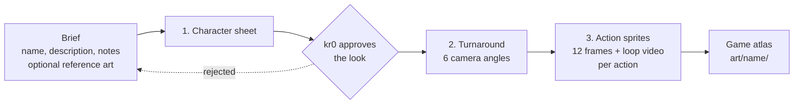

# Design workflows

Last updated: 26 October 2026 · Owner: art-director, approved by kr0

Every game makes its characters and generated art with the same tools: three Scenario workflows, the Scenario MCP server and its skills, and the gemini-creative MCP server. This page says what each one does, when to use it, and where its output goes. The general art rules are in [art style guides](art-style-guides.md).

## The character pipeline

A new character goes through the three workflows in order. Each step's output is the next step's input.

| Step | Workflow | Use it when | Input | Output |
| --- | --- | --- | --- | --- |
| 1 | Character sheet | A character exists only as words, or as loose concept art | Name, short description, optional notes, optional reference images | One editorial character sheet |
| 2 | Character turnaround | The look is approved and you need it from other angles | One reference image | Neutral front plus five camera angles |
| 3 | Action sprite studio | You need an animation for a game | One character image plus a view and action | 12-frame sprite sheet, 12 sliced frames, looping MP4 |

All three live in kr0's Scenario project (team `team_pG6MaimfJd9b9PTLYKkYR7fQ`, project `proj_T9sfQEQPZ2s4yoHgggBe1fAE`).

### 1. Character sheet

- **Link:** [Character Sheet Generator](https://app.scenario.com/workflows/wflow_F7ALXJPBLkhjsmstkjevZTmc?teamId=team_pG6MaimfJd9b9PTLYKkYR7fQ&projectId=proj_T9sfQEQPZ2s4yoHgggBe1fAE) (`wflow_F7ALXJPBLkhjsmstkjevZTmc`)
- **What it does:** turns a short brief into one landscape character sheet: front, side, back and three-quarter views, face close-ups, expression panels, a breakdown of the signature item, outfit and accessory panels, action poses, personality stats, skills, the name as a typographic label, and colour swatches. A prompt-writing step (Scenario LLM, Gemini 3.5 Flash Lite) merges the brief into a fixed three-paragraph prompt; GPT Image 2.5 Sunburst renders it at 3840 × 2160, high quality. Four fixed example images set the layout and editorial style (beige, minimalist); only their style is copied, never their subjects.
- **Inputs:**
  - `text1` Character Name (copied exactly onto the sheet)
  - `text8` Short Character Description (required): role, look, personality
  - `text2` Other Descriptions (optional): outfits, props, mood, style limits
  - `image2` Character Reference Image (optional, several allowed): locks face, body and art style. Leave it empty and the character is invented from the text.
- **Use it for:** the first approved look of any hero, enemy, boss or NPC; the reference sheet the art-director and writer work from; GDD and pitch art.
- **Don't use it for:** in-game art. The sheet is a reference, not a sprite source.
- **Tips:** a non-photoreal reference (ink, pixel, 3D) overrides the workflow's realism wording, so always pass the game's chosen-style art as the reference. Put outfit variety in Other Descriptions. If the name comes out wrong, the Name field holds more than the name.

### 2. Character turnaround

- **Link:** [Character Turnaround: 6 Angles (Camera-Locked)](https://app.scenario.com/workflows/wflow_9Li13dMMQK7TgLJFXgSKvpkh?teamId=team_pG6MaimfJd9b9PTLYKkYR7fQ&projectId=proj_T9sfQEQPZ2s4yoHgggBe1fAE) (`wflow_9Li13dMMQK7TgLJFXgSKvpkh`)
- **What it does:** re-photographs one character from six camera angles while the character stays frozen, so pose, proportions and design hold in every view. Step 1 renders a neutral eye-level front (azimuth 0°, elevation 0°), which becomes the "camera zero" reference. Step 2 renders five more angles, each fed with the original art and the neutral front: three-quarter front (45°), side profile (90°), rear (180°), low hero angle (−30°) and high angle (+60°). Every render is GPT Image 2.5 Sunburst, high quality, with shared master rules for identity, style, pose and framing, plus one angle spec per view.
- **Inputs:** `image1` REF 1, Character Reference (the identity and style master).
- **Use it for:** a model sheet before sprites or 3D; the side profile a side-view game needs; the top-down or isometric angle for Metr0niks; a rear view for an over-the-shoulder camera; image-to-3D inputs.
- **Tips:** check the neutral front before trusting the other five; if it drifts off-model, everything after it drifts too. To change one view, edit only its angle spec. To add an angle, copy one branch and rewrite its angle spec.

### 3. Action sprite studio

- **Link:** [Action Sprite Studio](https://app.scenario.com/workflows/wflow_hRqp6ojU7j6t1Az51W4XjaKd?teamId=team_pG6MaimfJd9b9PTLYKkYR7fQ&projectId=proj_T9sfQEQPZ2s4yoHgggBe1fAE) (`wflow_hRqp6ojU7j6t1Az51W4XjaKd`)
- **What it does:** makes one looping action animation from one character image. An LLM step writes a frame-by-frame plan from a fixed animation brief: frames 1 to 4 anticipation, 5 to 7 the strike, 8 to 10 follow-through with overlapping action, 11 recovery, 12 a bridge pose back into frame 1, with the feet locked to one anchor point. GPT Image 2 draws it as a 4 × 3 grid on white with black lines (1536 × 1024). The image slicer cuts the grid into 12 frames, and the frames become a looping MP4 at 6 fps.
- **Inputs:**
  - `image1` Character Image (required): use the turnaround view that matches the game's camera
  - `text2` View & Action: the camera and the move, for example "side view platformer, right hand, overhead hammer swing" or "isometric 3/4 top-down, firing shoulder cannon". It fills the blanks in the animation brief: game view, action, and which hand holds the weapon.
- **Use it for:** attack, idle, hit and walk cycles for prototypes; animation tests before committing to a rig; reference for hand-drawn or code-drawn animation.
- **Tips:** one action per run. Check the 12 frames for hand swaps and drift before packing them into an atlas. The white background has to be keyed out for the game; for transparent cut-out parts, use the GPT Image route in the Metr0niks ink prototype instead (`art/metr0niks/source/`).

### Before running from an agent

- **The workflows are drafts.** On 26 October 2026 all three had status `draft` and no compiled flow, so they run in the Scenario web app but not through the API or MCP `workflow_run`. To let agents run them, kr0 opens each one in Scenario and publishes it (status `ready`). Until then an agent can read a workflow (`workflow_get`) and reproduce its steps with `model_run`, or kr0 runs it in the app and the agent downloads the output.
- **Price it first.** Call `workflow_run` with `dry_run=true` and quote the cost before a real run. The character sheet and turnaround render at high quality on GPT Image 2.5 Sunburst, so a turnaround is six high-quality renders.
- **One run per character, one run per action.** None of the three loops over a list.
- **Three jobs at a time.** Scenario returned HTTP 429 at twelve parallel jobs.

## Where the output goes

| Output | Folder |
| --- | --- |
| Character sheets | `art/<game>/characters/<character>/sheet.png` |
| Turnaround views | `art/<game>/characters/<character>/turnaround/<angle>.png` (`front`, `three-quarter`, `side`, `rear`, `low`, `high`) |
| Sprite sheets, frames and loop videos | `art/<game>/characters/<character>/sprites/<action>/` (`sheet.png`, `frame-01.png` to `frame-12.png`, `loop.mp4`) |
| Inputs for every run (brief text, view and action, reference asset ids, workflow id, cost) | `art/<game>/prompts/<character>-<step>.txt` |

Note the workflow and model on the art board, as for any generated image. Raw runs and rejected takes stay in Scenario; only picked outputs come into the repo.

## MCP servers

### Scenario MCP

- **What it is:** Scenario's MCP server. It finds models, generates images, video, 3D and audio, runs workflows, uploads and downloads assets, and reads Scenario's skills.
- **Endpoint:** `https://mcp.scenario.com/mcp` (Streamable HTTP, OAuth sign-in with a Scenario account). It is declared in the repo's [`.mcp.json`](../.mcp.json), so Claude Code sessions opened on this repo offer it. In claude.ai, kr0 adds it once under Customize → Connectors → Add custom connector with the same URL.
- **Core loop:** `search` or `recommend` a model → `model_schema_get` → `model_run` → `jobs_wait` → `asset_display` → `asset_download`. Workflows: `workflow_get` for the input names → `workflow_run` with `dry_run=true` → `workflow_run` → `jobs_wait`.
- **Use it for:** all generated art and audio in the studio, and the three workflows above.
- **Credentials:** OAuth only. Never put a Scenario API key in the repo, a prompt or a message.

### Scenario skills

Scenario publishes tested procedures for its tools as skills. Read the one that fits before planning a multi-step job: it names the models, settings and traps. Through the MCP server, call `skill_get` (no name lists them all). To install them locally for Claude Code: `npx skills add scenario-labs/skills`.

| Skill | Use it for |
| --- | --- |
| `scenario` | Connecting, and the core loop. Read first. |
| `scenario-workflows` | Running the three workflows above: input names, dry runs, approval nodes. |
| `scenario-workflow-authoring` | Editing or publishing a workflow graph. |
| `scenario-consistency` | Keeping one character's look across many generations. |
| `scenario-identity-library` | Turning an approved character into a reusable identity with its reference set. |
| `scenario-orbit-views` | Extra camera angles beyond the turnaround workflow. |
| `scenario-sprite-animation` | Walk, idle and attack cycles in 4 or 8 directions, isometric sheets, GIFs. |
| `scenario-side-view-game-kit` | Side-view hero and enemy sheets, tiles and backgrounds for a side-scroller. |
| `scenario-game-assets` | Icons, props, loot, tilesets, UI pieces. |
| `scenario-textures` | Seamless tiles and texture packs. |
| `scenario-3d` | Image-to-3D meshes from turnaround views. |
| `scenario-audio`, `scenario-sonilo` | Sound effects and music; Sonilo is the cheap SFX route. |
| `scenario-refine-loop`, `scenario-quality-gate` | Checking an output against the brief and iterating, before it ships. |
| `scenario-model-training` | Training a style or character model when references stop being enough. |

### gemini-creative MCP

- **What it is:** an MCP server that connects agents to Google Gemini's creative models for image generation and editing (Gemini image, "Nano Banana"). Listing: [mcpmarket.com/server/gemini-creative](https://mcpmarket.com/server/gemini-creative).
- **Use it for:** quick concept sketches and edits, a second opinion beside a Scenario render, and image edits by plain instruction ("make the armour rust red"). Final in-game art still goes through the chosen style and the Scenario pipeline, so one game's art comes from one source.
- **Setup:** the listing could not be opened from the studio's cloud environment, so its package and install command are not confirmed yet. It is not in `.mcp.json` until they are. It needs a Gemini API key, which kr0 sets in the environment (`GEMINI_API_KEY`), never in the repo. In claude.ai cloud sessions the Gemini API host is already reachable with credentials injected.
- **Status:** pending setup by kr0.

## Rules

- **The game's chosen style comes first.** Feed each workflow with art in the game's chosen style from [art style guides](art-style-guides.md). While a game's style is "Not chosen", label character art as exploration.
- **kr0 approves the character sheet** before turnarounds or sprites are made from it.
- **Record every run** in `art/<game>/prompts/` (inputs, workflow id, model, cost), as with any generated image.
- **Check before use:** remove garbled AI text, check hand swaps and drift in sprite frames, and say what was fixed in the art README.
- **Log spend.** Scenario credits per character go into the game's tuning history next to the story's tokens.
