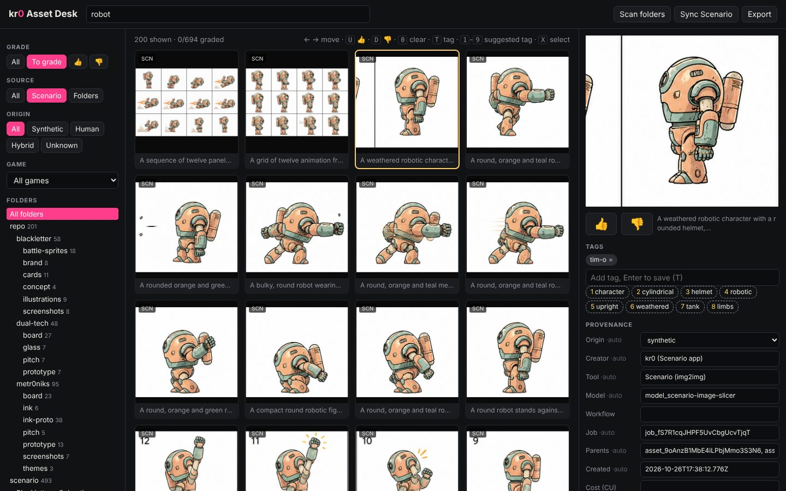

# kr0 Asset Desk

Last updated: 27 October 2026 · Owner: tools-programmer, for kr0's review · Version 0.1

A small app for grading, tagging and tracing studio art. It shows the Drive art folder, the repo's `art/` folder and the Scenario library in one grid. You give each asset a thumbs up or down, tag it (with suggested tags), and record where it came from: who or what made it, with which tool, model, workflow and prompt.

Used by every game. The planned features are in [FEATURES.md](FEATURES.md).



## Why it's a local service

Google Drive for Desktop puts the art folder on kr0's PC as `G:\My Drive\…`, and only that machine can see it. A browser page can't read a folder on its own, so a small local service does it: a single Python file, standard library only, that serves the app at `http://127.0.0.1:8765` and only answers requests from the same machine.

## Run it (Windows)

1. Install Python 3.9 or newer from python.org (tick "Add to PATH").
2. Set your Scenario API key once as user environment variables `SCENARIO_API_KEY` and `SCENARIO_API_SECRET` (Scenario: Settings, API keys). Without them the app still works on folders; Sync Scenario will fail.
3. Double-click `start-asset-desk.bat`. It opens the app in your browser and scans `G:\My Drive\kr0 Studio Art` plus this repo's `art/`. Edit the `DRIVE_ART` line if your folder has a different name.

Any other system: `python asset_desk.py --root drive="/path/to/kr0 Studio Art" --root repo=../../art --scan`. Run `python asset_desk.py --help` for every option.

## Use it

- **Sync Scenario** pulls the whole library (images, video, audio, 3D) with its prompts, models, parents and captions. **Scan folders** re-reads the folders. Neither changes or moves any file.
- The default view is **To grade**. `U` is thumbs up, `D` thumbs down, `0` clears; the app moves to the next asset after each grade.
- `T` adds a tag. Suggested tags appear under the box; press `1` to `9` to accept one. Hover a suggestion to see why it was offered.
- Provenance fields fill themselves where Scenario or the file says something (marked "auto"). Anything you type is yours and is never overwritten by a later sync.
- `X` or shift-click selects several assets for bulk grading, tagging or setting origin.
- **Export** downloads a JSON manifest of what's on screen.
- **Push tags and grade to Scenario** (on a Scenario asset) adds the local tags plus `kr0-up` or `kr0-down` to the asset in Scenario. It's only done when you press it.

## Where the data lives

The catalog sits next to the art so Drive syncs and versions it:

| File | Holds |
| --- | --- |
| `<Drive art folder>/_catalog/catalog.json` | Current grade, tags, game and provenance of every asset |
| `<Drive art folder>/_catalog/events.jsonl` | Every change, one JSON line each: time, who, asset, before and after |

Asset ids are `scn:<Scenario asset id>` or `file:<folder label>:<path inside that folder>`. Provenance fields: `origin` (synthetic, human, hybrid, unknown), `creator`, `tool`, `model`, `workflowId`, `jobId`, `parentIds`, `prompt`, `sourceUrl`, `createdAt`, `costCU`, `license`, `c2pa`, `c2paSigner`, `notes`. The studio-wide asset rules and manifest format are being written in the Drive storage work; this app follows them once they land.

**About C2PA:** files that went through Claude's file store carry a Content Credentials stamp signed by Anthropic that says "Claude provided this file". That records custody, not who made it, so the app shows the signer but doesn't set the origin from it.

## Test

```
python -m unittest test_asset_desk
```

## Limits in 0.1

- The Scenario tag write (`PUT /v1/assets/{id}/tags`) hasn't been tried against the live API yet.
- Scenario image links are signed and expire after about ten days; Sync Scenario refreshes them.
- Opening an asset from a Drive folder set to "stream files" downloads it into the Drive cache (`F:\Drive`). Scanning only reads names and sizes.
- Suggested tags get better as you tag: they lean on the tags you've already used.
- The pink of the 0 in the header is a placeholder until kr0 sets `--r0-pink` (see [brand rules](../../studio/brand.md)).
