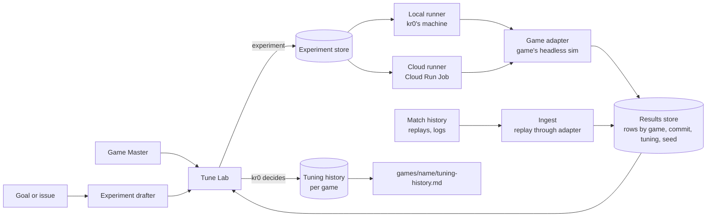

# chronos-sim: project plan

Oct 23, 2026 · @kr0 · Draft for kr0's review

chronos-sim is the studio's simulation and tuning platform, built in `tools/chronos-sim/` and shared by every kr0 game. It grows out of the sweep tooling and Tuning Lab in the Blackletter build. This plan reviews what Blackletter has, sets out what the general platform must do, and breaks the work into phases. It follows [simulation and tuning](../../studio/simulation-and-tuning.md); nothing in it changes that standard.

Everything in this plan is proposed until kr0 approves it. Decisions still owed are in section 8.

---

## 1. What kr0 asked for

| # | Requirement |
| --- | --- |
| R1 | A Game Master of any kr0 game can see the game's tunable values and tweak them as knobs. |
| R2 | A Game Master sets up an experiment from those knobs and starts it. |
| R3 | An experiment runs in the cloud or on kr0's local machine. |
| R4 | Results are shown visually, at least as well as Blackletter's Tuning Lab does today. |
| R5 | The platform takes in a game's match history (for example Blackletter replays) and shows it with the same visualizations, so choices rest on real play as well as simulation. |
| R6 | chronos-sim keeps and updates each game's tuning history. |
| R7 | Blackletter's existing tuning history migrates into it. |
| R8 | A Game Master can describe a goal (a balance target or an issue) and get a proposed experiment that tests it. |
| R9 | It supports everything Blackletter uses today, so Blackletter can move onto it without losing anything. |

## 2. What Blackletter has today

Reviewed in the Blackletter build (`kr0/blackletter-chronos`, `main` at `1ec8408`, 23 Oct 2026), mainly `docs/simulations.md`, `docs/simulation_tuning_plan.md`, `docs/deployment.md` (Simulation jobs), `docs/tuning_agent_playbook.md`, `scripts/sim/`, `server/sim*.js`, `server/suggest.js`, `server/played.js` and `src/lab/`.

| Piece | Where | What it does | Blackletter-specific parts |
| --- | --- | --- | --- |
| Simulators | `scripts/sim/match.mjs`, `duel.mjs`, `upgrade_duel.mjs`, `difficulty.mjs` | Headless bot-vs-bot matches, unit duels, upgrade-card value, difficulty ladder, all on the real engine | Every one: the scenarios are the game |
| Result row | `simulateMatch` | One row per match: KPIs, a 5 s time series, per-seat hex heatmaps, the order log, `engine` and `tuning` hashes | KPI names, hex heatmaps, series fields |
| Store and cache | `scripts/sim/store.mjs`, `hash.mjs` | `sim-results/<run>/run.json` + `rows.jsonl`. Cache key `engine:tuning:seed:maxMinutes`, so no match is played twice | The key's fields |
| Sweep runner | `scripts/sim/sweep.mjs` | Manifest of baseline + variants (tuning and unit-profile overrides), paired seeds, a `worker_threads` pool, early stopping | Override shapes (`profiles`) |
| Stats, scorecard and report | `stats.mjs`, `score_core.mjs`, `score.mjs`, `report.mjs`, `targets.mjs` | Mean and 95% CI, paired t-test against baseline, Wilson interval for seat share, early stopping, a one-line-per-variant scorecard, a markdown results block and `docs/sim/history/<version>.json` | Targets are hard-coded in `targets.mjs` (8 to 12 min, while the studio GDD now says 12 to 16, GDD-D14). The scorecard prints a "verdict" column |
| Cloud runs | Cloud Run Job `chronos-sim` (`server/sim_job.js`), `scripts/sim/cloud.mjs`, `server/sim.js` | Runs the game server's image, shards `(variant, seed)` pairs across tasks, writes `simRuns/{runId}` and its rows to Firestore, early-stops across tasks, retry-safe. Started from the CLI or `POST /api/sim/runs`; `sim:pull` merges results back into the local store | Project `blackletter-kr0nos-dev`; image built from the build's `main` |
| Tuning Lab | `lab.html`, `src/lab/` | Runs (live cards and scorecard), Compare (strip plots, intervals, paired differences, heatmaps, played games), Evolution (KPIs by tuning version, response curves, combat triangle), Knobs (ledger with meanings and slopes, "Add to sweep", sweep draft), Replays (worker playback with a hash check) | Imports `src/tuning.js`, the hex renderer, the triangle, `TUNING_LOG` directly |
| Access | `src/lab/gate.js`, `firestore.rules`, `config/gm` | Google sign-in; a Game Master allowlist reads runs and match logs; no client writes | One allowlist for one game |
| Match history | `server/match.js`, `server/played.js`, `src/lab/played*.js`, `src/lab/replays.js` | Online and uploaded offline battles stored as `matchLogs/{id}` + chunks; the Lab replays each log into a result row in a worker, caches rows in IndexedDB, and compares groups unpaired (Welch's t) | Log format and the replay function |
| Sweep suggester | `server/suggest.js`, `src/lab/suggest.js` | A Game Master's sentence becomes a draft manifest through one structured-output Claude API call. Known numeric keys only, values from 0 to 10× current, at most 8 variants and 50 matches, rate-limited, a person presses Start | The knob docs and targets it sends |
| Tuning ledger | `src/tuning.js` `TUNING_VERSION` (now 5.1.0) and `TUNING_LOG` (34 entries, 1.0.0 to 5.1.0); `docs/sim/history/` (7 aggregates, 1.5.0 to 2.14.0); `docs/tuning_guide.md` results blocks | What changed, why and the evidence; aggregates behind the Evolution charts | Lives inside the game's code |
| Agent loop | `.claude/skills/tune/`, `docs/tuning_agent_playbook.md` | A token-frugal loop: manifest, sweep, read only the scorecard, decide, ledger entry. Measured at about 320 tokens per balance question against about 23,600 before | Commands and targets |

**What to keep.** The design is sound and most of it is already game-agnostic: a deterministic engine, paired seeds, a content-addressed cache, rows that carry their own replay log, local and cloud runners that write the same rows, a read-only Lab, and a model that drafts but never runs anything. chronos-sim should lift these rather than redesign them.

**What has to change to share it.**

- Game knowledge (scenarios, KPIs, targets, knob meanings, heatmap geometry, replay drawing) moves behind a per-game adapter.
- Targets come from each game's Simulation section, as the studio standard says, not from code in the tool.
- The scorecard reports observations. Its "verdict" column becomes flags that a value is outside its target, without "ok".
- The tuning ledger moves out of game code into chronos-sim's history, and the game reads its current values from there or from a file chronos-sim writes.
- Runs, logs and access are keyed by game.

## 3. Platform shape

### 3.1 Game adapter (one per game)

The only part a game writes. It lives with the game's code and is versioned with it.

| Adapter part | Blackletter today |
| --- | --- |
| `knobs()`: every tunable key, its current value, type, range and one-line meaning | `DEFAULT_TUNING`, `UNIT_PROFILES`, `src/generated/tuningDoc.js` |
| `scenarios()`: the named setups a run can use, with their parameters | match (with or without prep, pace, board), duel, upgrade duel, difficulty ladder |
| `run(scenario, overrides, seed, caps)`: plays one run to its end and returns a row: metrics, optional series and heatmaps, the input log, a final state hash | `simulateMatch`, the duel and upgrade scripts |
| `replay(log)`: rebuilds a run from a stored log and returns the same row and hash | `src/replay.js` `replayMatch` |
| `metrics()`: names, units, and how to aggregate each (mean, share, count) | the scorecard columns and history KPIs |
| `views` (optional): Lab plugins for game-specific pictures | hex heatmaps, the combat triangle, the replay renderer (`HexRenderer`) |
| `engineHash()`: a hash of the code the results depend on | `scripts/sim/hash.mjs` |

Targets are not in the adapter. chronos-sim reads them from the game's Simulation section (a fenced table or a small `simulation.json` next to the game docs; decision D4).

### 3.2 Experiment

The Blackletter manifest, made general. Stored as a JSON file in the game's folder and as a record in the experiment store.

| Field | Meaning |
| --- | --- |
| `game`, `name`, `question` | Which game, a short name, and the question in words |
| `goal` | Optional link to a Game Master goal (3.6) |
| `build` | Repo and commit of the game code to run; the engine hash is recorded when it runs |
| `scenario` | A scenario id from the adapter, with parameters |
| `baseline`, `variants` | Knob overrides, as today |
| `seeds` | Start, count, paired (default yes) |
| `caps`, `earlyStop` | Per-run cap; early stopping on or off |
| `runner` | `local`, `cloud`, or `any` |

### 3.3 Runners

- **Local runner:** a CLI on kr0's machine (`chronos run <experiment>`), Blackletter's worker pool made general. Free, and the only option for code that isn't pushed.
- **Local worker:** the same runner in a mode that picks up queued experiments from the store. This is how a Game Master in the web Tune Lab starts a run on kr0's machine.
- **Cloud runner:** the Cloud Run Job `chronos-sim`, made general: it loads the adapter of the experiment's game and commit, shards `(variant, seed)` pairs across tasks and writes rows to the store. Early stopping and retry-safety stay as they are.

All three write the same rows, so a run scores the same wherever it ran.

### 3.4 Results store

Rows keyed by `game : engine hash : tuning hash : scenario : seed : caps`, so nothing is played twice for any game. Locally, `sim-results/<game>/<run>/` as today; in the cloud, Firestore `games/{game}/runs/{runId}` and its rows (decision D2). Rows from played matches (3.5) sit in the same store, marked as played rather than simulated.

### 3.5 Match history

- **Ingest:** any game that stores input logs sends them to chronos-sim (Blackletter's `matchLogs` today). chronos-sim replays each through the game's adapter in a worker, checks the final hash, and stores the row.
- **Use:** played games get the same Runs, Compare and Replays views as simulated ones. They share no seeds, so Compare uses unpaired tests, as Blackletter's Played games view does now. Played and simulated groups can sit side by side, for example Sebastion vs Sebastion against humans vs Sebastion at the same tuning.
- **Divergence:** a log that no longer replays (the engine changed) is listed with an error, never silently dropped.

### 3.6 Tune Lab

The web app for Game Masters, lifted from Blackletter's Tuning Lab, with a game picker at the top.

| Tab | Shows | Comes from |
| --- | --- | --- |
| Goals | The game's open goals and issues, each with its experiments and outcome | New |
| Knobs | Every tunable with meaning, current value, last sweep and measured slope. "Add to sweep" builds the experiment draft | Knobs tab |
| Runs | Experiment draft, Start (local or cloud), live progress and scorecard | Runs tab |
| Compare | Strip plots with target bands, intervals, paired differences, game views such as heatmaps, played vs simulated | Compare tab |
| Evolution | Each metric by tuning version, annotated from the tuning history; response curves; game views such as the combat triangle | Evolution tab |
| Replays | Every stored run and played match, with playback through the game's view plugin and a hash badge | Replays tab |
| History | The tuning history: each version's changes, why, the evidence, who decided | New |

The Lab stays read-only toward games: it never changes a game's values directly. Applying a change is a separate step (3.7).

### 3.7 Tuning history

One ledger per game, kept by chronos-sim as data (`games/<name>/tuning/ledger.json` or similar; decision D3). An entry holds the version, date, changed keys with old and new values, the reason, the evidence (experiment id and the scorecard lines quoted), who decided, and tokens spent where a story closed.

- **Apply:** when kr0 accepts a variant, chronos-sim writes the new values into the game's tuning file (Blackletter: the `cards:apply` changes format), bumps the version, appends the entry, re-runs the game's standard baseline and stores its aggregate (today's `docs/sim/history/<version>.json`).
- **Render:** `games/<name>/tuning-history.md` is generated from the ledger, so the doc and the data can't drift. The hand-written parts (the "What it says" readings, planned stories) stay in the file outside a generated block.
- **Rule:** the history is append-only. A wrong entry is corrected by a new entry.

### 3.8 Experiment drafter

Blackletter's sweep suggester, made general. A Game Master writes a goal ("Shooter should beat Chopper 65 to 80% without moving the other legs") or an issue ("battles stall at even nodes"). The drafter sends the game's knobs and meanings, targets, scenarios, recent results and history as data, and returns a draft experiment with a rationale. It keeps today's safety rules: no tools, structured output only, validated against the game's known keys and limits, and a person edits it and presses Start.

## 4. Migrating Blackletter

| Source | Becomes | Notes |
| --- | --- | --- |
| `TUNING_LOG` in `src/tuning.js` (1.0.0 to 5.1.0, 34 entries) | Ledger entries; `changes` and `rationale` carried word for word | Old and new values parsed where the text states them; otherwise left as text |
| `docs/sim/history/*.json` (7 versions) | Baseline aggregates attached to their versions | Engine and tuning hashes kept |
| `games/blackletter/tuning-history.md` (baseline v2.14.6, the two duel sweeps, 3.0.0 and 4.0.0) | Ledger entries and recorded experiments for the sweeps | Planned stories stay as hand-written text |
| `docs/tuning_guide.md` results blocks | Attached to their versions as evidence | Already generated by `sim:report` since 2.8.0 |
| `sim/experiments/*.json` | Experiments in the new format | A converter; the old format stays readable |
| `sim-results/` (local) and Firestore `simRuns` | Imported runs | Optional: rows are cheap to regenerate from the cache keys |
| Firestore `matchLogs` | Match history | Read in place or copied, decision D2 |
| `scripts/sim/targets.mjs` | Blackletter's Simulation section | kr0 settles which length target holds: 8 to 12 (build) or 12 to 16 (GDD-D14) |

Done when the migrated ledger renders a `tuning-history.md` that holds everything the current file says, the Evolution tab shows the same curves as Blackletter's Lab, and a migrated experiment scores the same as it does in the build.

The ledger reaches 5.1.0 while the studio tuning history stops at 4.0.0, so the migration also brings the studio copy up to date.

## 5. Phases

Token figures are planning estimates for agent work including one review and one fix round, sized against Blackletter's T1 to T16. They're not measured, and the studio's 40% rework reserve goes on top.

| Phase | Delivers | Main roles | Estimate |
| --- | --- | --- | --- |
| 0. Contracts | Adapter interface, experiment, row and ledger schemas; decisions D1 to D6 settled | technical-director, systems-designer | 0.4M |
| 1. Core, local | `tools/chronos-sim` package: store and cache, sweep runner, stats, scorecard with observations, report. Blackletter adapter. **Parity check:** the same manifest scores the same in the build and in chronos-sim | tools-programmer, systems-designer | 2.0M |
| 2. Tuning history | Ledger, apply, generated `tuning-history.md`; Blackletter migration (section 4) | tools-programmer, systems-designer | 1.2M |
| 3. Tune Lab | Lab lifted out of `src/lab/` with a game picker and view plugins; Knobs, Runs, Compare, Evolution, Replays, History tabs; Blackletter's views as the first plugins | ui-programmer, tools-programmer | 3.0M |
| 4. Runners | Local worker for queued runs; Cloud Run Job made general; Firestore layout by game; per-game Game Master access | devops-engineer, security-engineer | 1.5M |
| 5. Match history | Ingest of Blackletter's match logs; played rows; played vs simulated in Compare | tools-programmer, analytics-engineer | 1.0M |
| 6. Goals and drafter | Goals tab; experiments linked to goals and ledger entries; the drafter made general | tools-programmer, systems-designer | 1.0M |
| 7. Second game | Metr0niks adapter around `sim.js` (`MetroSim.create`, `step`, a metrics record and a state hash), so the contracts are proven on a game they weren't built from | gameplay-programmer, systems-designer | 0.8M |
| | **Total** | | **10.9M (15.3M with reserve)** |

Order: 0 → 1 → 2. Phase 3 can start once phase 1's rows exist. Phase 4 needs 1. Phase 5 needs 3. Phase 6 needs 2 and 3. Phase 7 can start once phase 0 is done.

**Blackletter keeps working throughout.** Its scripts and Lab stay in the build until chronos-sim passes the parity check and its Lab matches the old one. Then the build's copies are retired with a decision in Blackletter's TDD history.

## 6. Milestones

| Milestone | Proof |
| --- | --- |
| M1: local parity | `chronos run` on `default-24` gives the same rows and scorecard as `npm run sim:sweep` in the build |
| M2: history migrated | Generated `games/blackletter/tuning-history.md` covers 1.0.0 to 5.1.0; kr0 reviews it |
| M3: Lab for Blackletter | kr0 opens the Tune Lab, picks Blackletter, adds two knobs to a sweep, starts it locally and reads Compare and Evolution |
| M4: cloud and local queue | The same experiment runs in the cloud and on kr0's machine from the Lab, and the results match |
| M5: real matches | A played Blackletter match replays in the Lab and shows next to a simulated run at the same tuning |
| M6: goal to experiment | A written goal produces a draft experiment that kr0 edits and runs |
| M7: second game | A Metr0niks sweep runs and shows in the Lab with no Blackletter code involved |

## 7. Risks

| Risk | What could go wrong | How to handle it |
| --- | --- | --- |
| Two homes for the code | The adapter and engine live in the game's repo while the platform lives in the studio repo, and the versions drift | Experiments name a commit; the engine hash is recorded on every row; the parity check runs in CI |
| Over-generalising | Contracts shaped by Blackletter don't fit a real-time voxel game | Phase 7 (Metr0niks) tests the contracts early; adjust in phase 0 if a dry run fails |
| Bots aren't players | Good sweep numbers on a bad-feeling game | Played-match history (phase 5) next to simulation; the standard's playtest rule |
| Cloud image per game | Each game needs its code in the job's image | One image per game and commit, or a generic image that fetches the build (D5) |
| Access and secrets | Match logs and allowlists cross games | Per-game Game Master lists; no client writes; rules tests carried over |
| Determinism gaps | Dropfront and Dual Tech prototypes use `Math.random` today | They join only once they meet the studio standard |

## 8. Decisions for kr0

| # | Decision | Options | Leaning |
| --- | --- | --- | --- |
| D1 | Where Tune Lab is hosted | Studio site's GCP project; Blackletter's Firebase project; a new kr0 project | A new kr0 project, so no game owns the platform |
| D2 | Store for runs and match history | Keep Firestore (as Blackletter); Firestore plus Cloud Storage for large rows; another database | Firestore plus Cloud Storage: rows over 1 MiB today drop their log |
| D3 | Where each game's ledger lives | In the studio repo next to its docs; in the game's own repo | Studio repo, so `tuning-history.md` is generated beside the data |
| D4 | How a game states targets for the tool | A table in the Simulation section; a `simulation.json` next to it | `simulation.json`, rendered into the section |
| D5 | How the cloud runner gets a game's code | One image per game, built on push; one generic image that fetches the commit | Generic image, so branches can run in the cloud too |
| D6 | Who may start runs | kr0 only; Game Masters per game; agents within a budget | Game Masters per game, with a run cap per experiment |
| D7 | Blackletter's length target | 8 to 12 min (build) or 12 to 16 (GDD-D14) | kr0's call |
